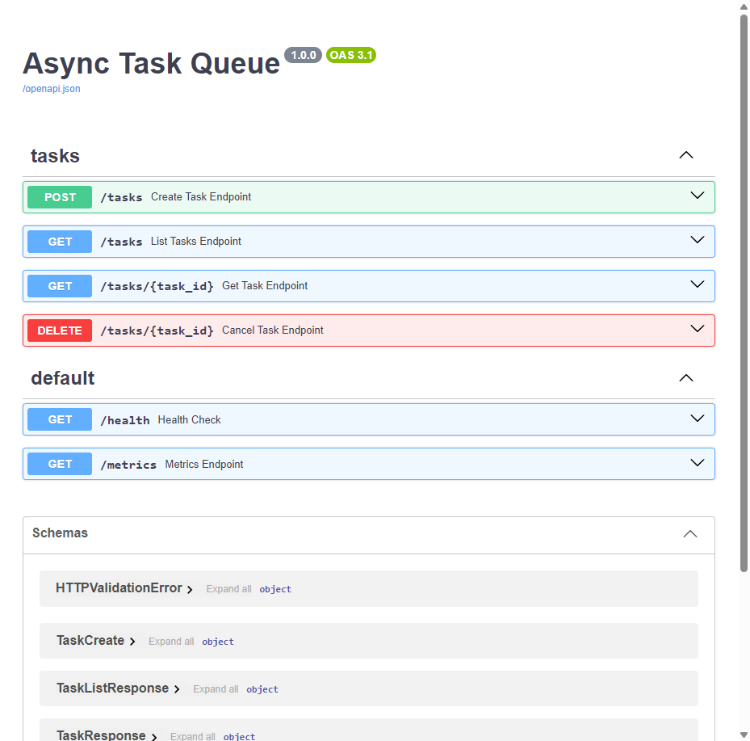
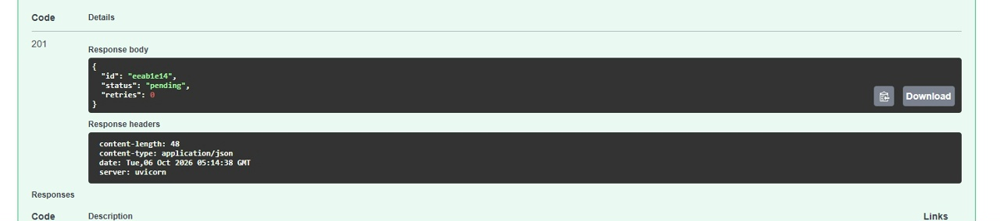
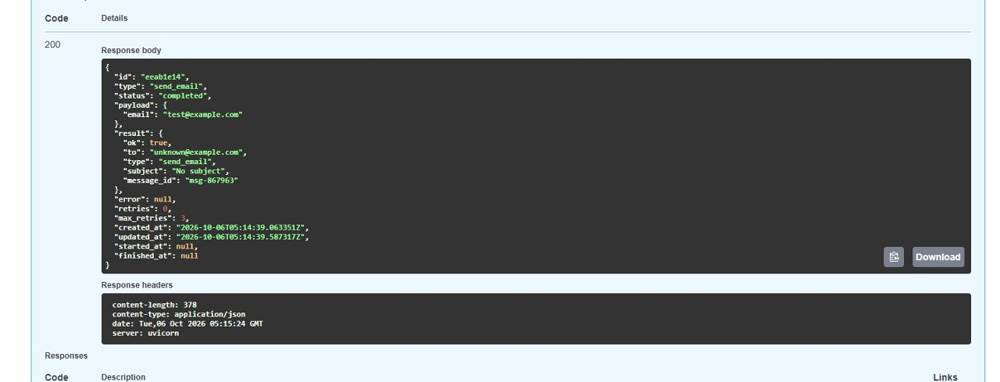
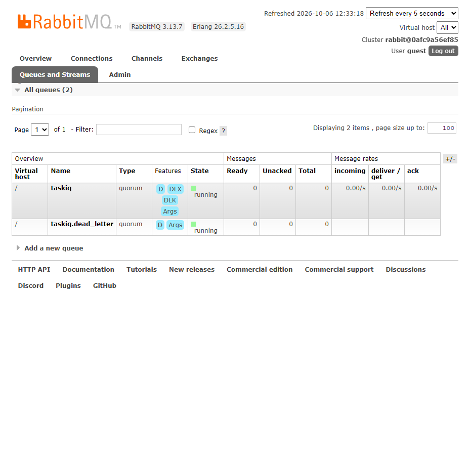
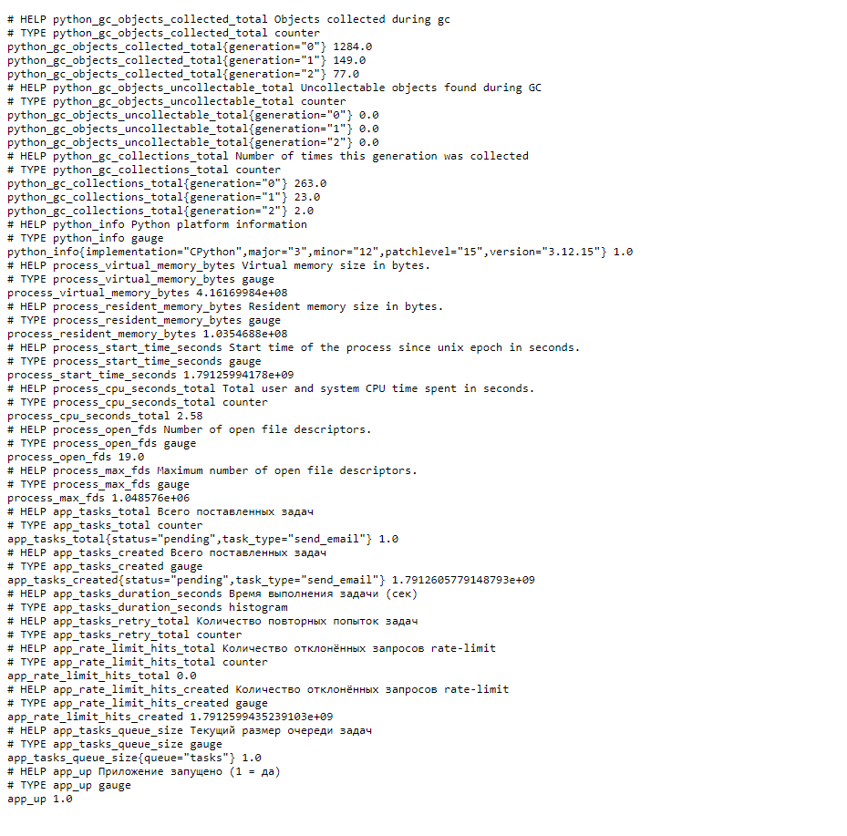
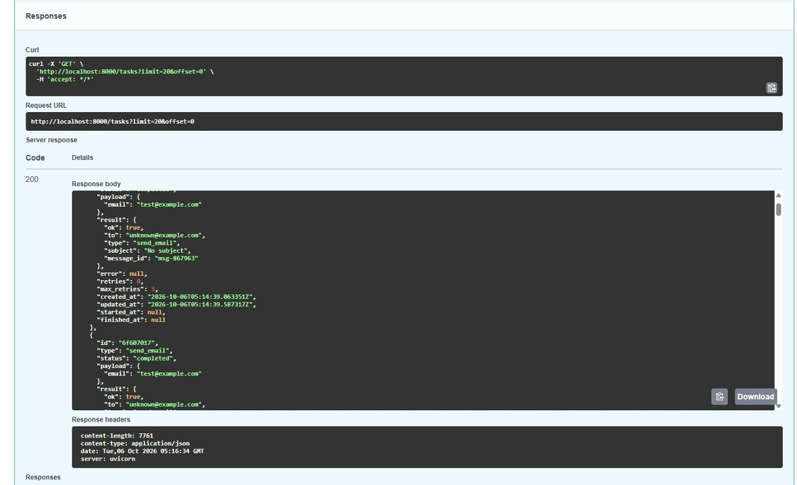
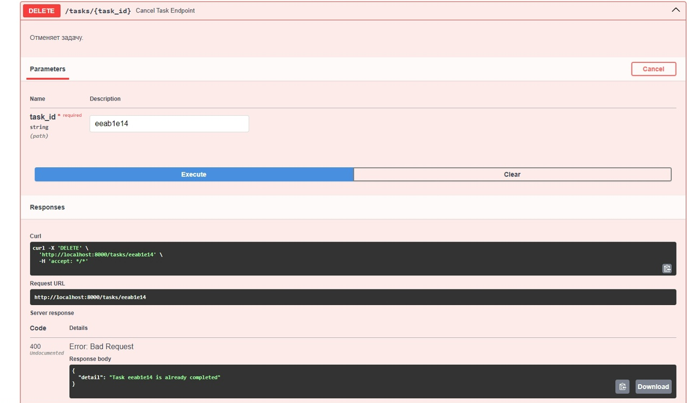
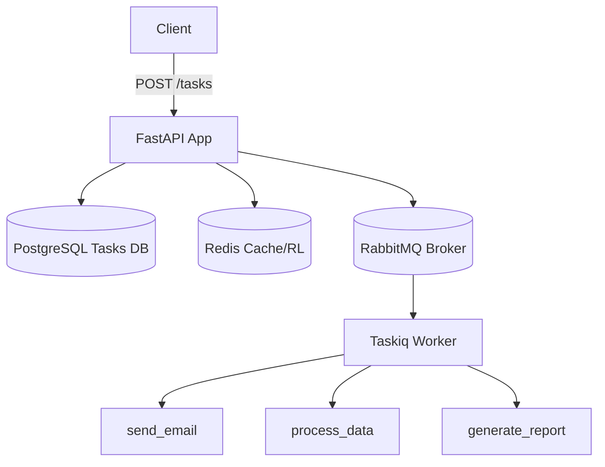

# Async Task Queue

Асинхронная система фоновых задач на Python с использованием FastAPI, Redis, RabbitMQ и PostgreSQL.

## Бейджи

[](https://www.python.org/downloads/release/python-3120/)
[](https://fastapi.tiangolo.com/)
[](https://www.docker.com/)
[](https://github.com/SmailsZX/async-task-queue)

## Скриншоты

### Swagger UI — все эндпоинты API



### POST /tasks — создание задачи (201 Created)



### GET /tasks/{id} — статус completed



### RabbitMQ Management — очередь tasks



### Prometheus метрики



### GET /tasks — список задач с пагинацией



### DELETE /tasks/{id} — отмена задачи



## Архитектура



## Стек

- **Python 3.12+**
- **FastAPI** — REST API
- **asyncio** — асинхронность
- **Redis** — кэш результатов, rate limiting, очереди
- **RabbitMQ** — broker для распределённых задач (taskiq-aio-pika)
- **Taskiq** — фоновые задачи с retry и dead-letter
- **PostgreSQL** — персистентное хранение задач (SQLAlchemy 2.0 + Alembic)
- **Prometheus** — метрики
- **Structlog** — логирование
- **Docker** — контейнеризация
- **pytest + pytest-asyncio** — тесты

## Быстрый старт

```bash
# Запуск всех сервисов через Docker
cd async-task-queue
docker-compose up -d

# API: http://localhost:8000/docs
# RabbitMQ: http://localhost:15672 (guest/guest)
# Metrics: http://localhost:8000/metrics
```

## API Endpoints

| Метод | Эндпоинт | Описание |
|-------|----------|-----------|
| POST  | `/tasks` | Создание задачи |
| GET   | `/tasks/{task_id}` | Получение задачи |
| GET   | `/tasks` | Список задач |
| DELETE| `/tasks/{task_id}` | Отмена задачи |
| GET   | `/health` | Health Check |
| GET   | `/metrics` | Метрики Prometheus |

## Установка

```bash
git clone https://github.com/SmailsZX/async-task-queue.git
cd async-task-queue

python -m venv venv
source venv/bin/activate  # Linux/Mac
venv\Scripts\activate     # Windows

pip install -r requirements.txt
```

## Запуск через Docker

```bash
docker-compose up -d

docker-compose logs -f app
docker-compose logs -f worker
```

## Ручной запуск

```bash
# Сервер
uvicorn app.main:app --host 0.0.0.0 --port 8000 --reload

# Воркер
taskiq worker app.tasks.worker:broker
# или
python -m app.tasks.worker_runner
```

## Типы задач

| Тип | Описание | Payload |
|-----|----------|---------|
| `send_email` | Имитация отправки email | `{to, subject, body?, fail?, delay?}` |
| `process_data` | Обработка данных | `{data, fail?, delay?}` |
| `generate_report` | Генерация отчёта | `{report_type, fail?, delay?}` |

## Переменные окружения

Скопируйте `.env.example` в `.env` и настройте под вашу среду:

```bash
cp .env.example .env
```

## Тесты

```bash
# Запуск всех тестов
pytest

# С покрытием
pytest --cov=app --cov-report=term-missing

# Конкретный файл
pytest tests/test_api.py -v
```

## Структура проекта

```
async-task-queue/
├── app/
│   ├── main.py
│   ├── config.py
│   ├── db.py
│   ├── api/
│   │   ├── routes.py
│   │   └── deps.py
│   ├── core/
│   │   ├── redis.py
│   │   ├── rabbit.py
│   │   └── queue.py
│   ├── tasks/
│   │   ├── handlers.py
│   │   ├── worker.py
│   │   └── worker_runner.py
│   ├── models/
│   │   └── task.py
│   ├── schemas/
│   │   └── task.py
│   └── utils/
│       ├── logger.py
│       └── metrics.py
├── tests/
│   ├── conftest.py
│   ├── test_api.py
│   ├── test_queue.py
│   └── test_worker.py
├── docker-compose.yml
├── Dockerfile
├── requirements.txt
├── .env.example
├── .gitignore
└── README.md
```

## Обработка ошибок

- **Retry**: до `max_retries` попыток с экспоненциальной задержкой
- **Timeout**: задача прерывается по истечении `TASK_TIMEOUT`
- **Dead Letter Queue**: задачи, исчерпавшие retry, попадают в `tasks.dlq`
- **Rate Limiting**: ограничение 100 запросов/минуту на API

## Лицензия

MIT
